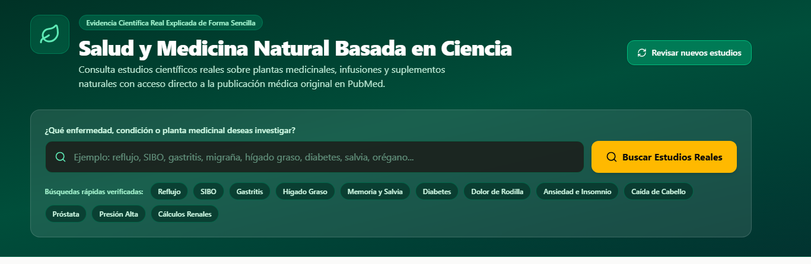
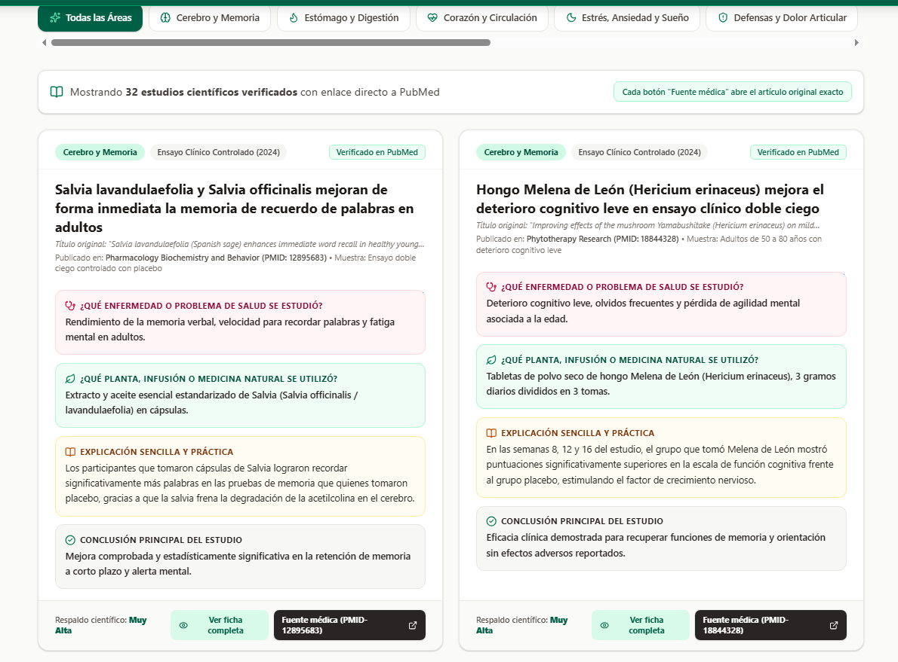

# 🌿 BioNatEvidence

Portal web interactivo que recopila y traduce la evidencia científica más reciente sobre biomedicina, fitoterapia clínica y medicina natural en un formato práctico y fácil de entender.

## 📸 Capturas de Pantalla

*Exploración de estudios clínicos clasificados por áreas de la salud.*

*Motor de búsqueda conectado a PubMed con enlaces directos a cada investigación.*

## 🔬 Características Principales

- **Biblioteca por Sistemas:** Cobertura de salud digestiva, neurológica, hormonal, articular, respiratoria y metabólica.
- **Formato Práctico:** Cada estudio detalla la condición analizada, planta o preparado natural utilizado, resumen sin tecnicismos y conclusión clínica.
- **Acceso a PubMed:** Botón directo a la fuente científica original (PMID) para cada publicación.
- **Búsqueda en Vivo:** Consulta artículos en bases de datos biomédicas internacionales en tiempo real.
